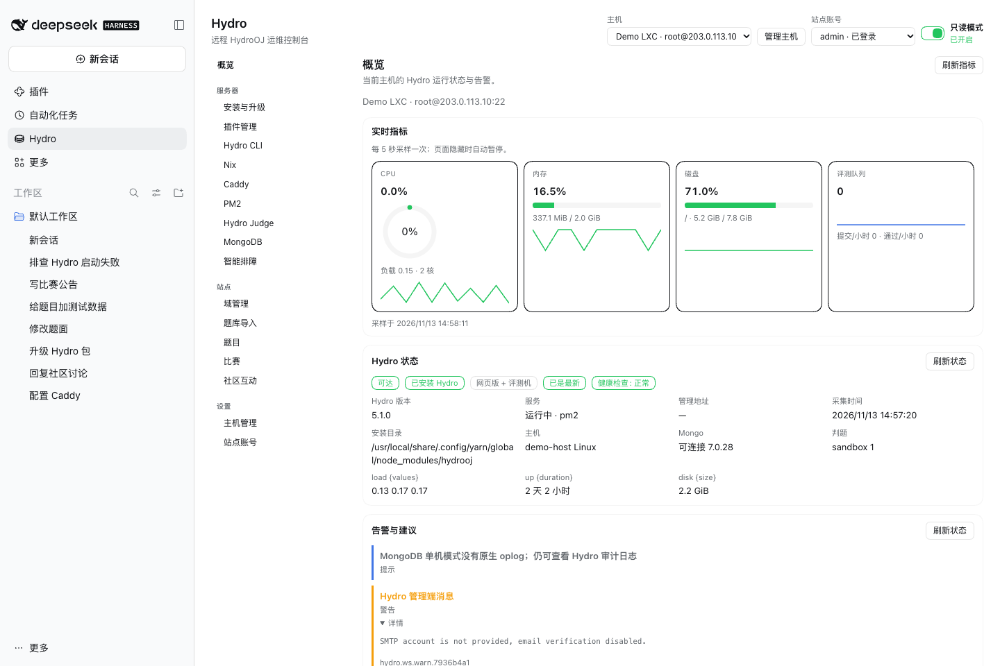
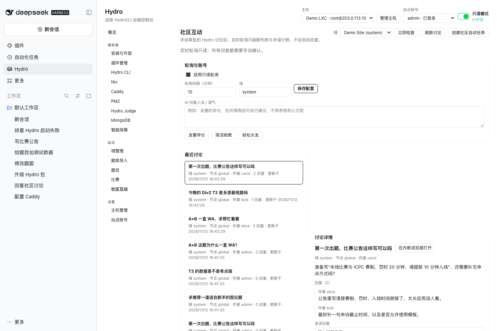
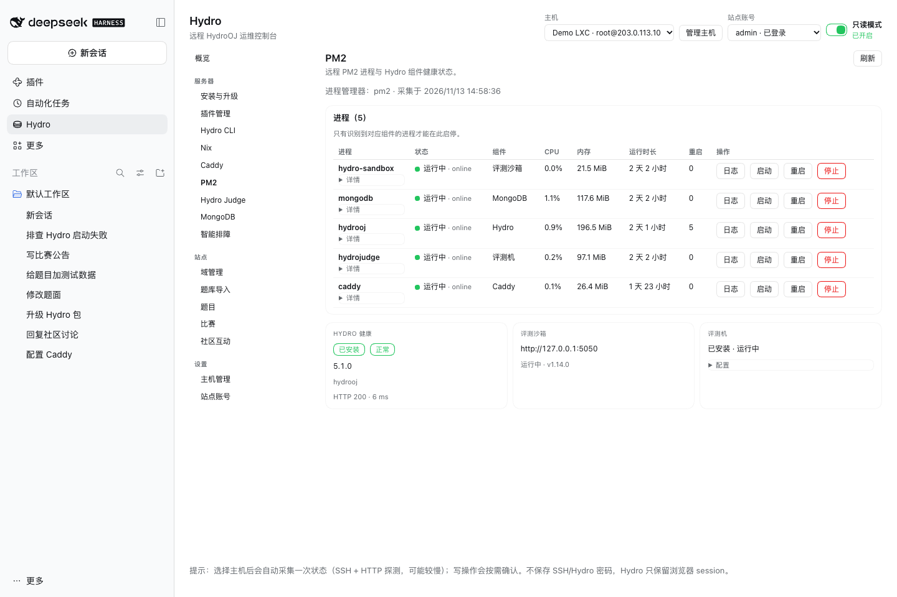

# dsh-hydro

**HydroOJ 运维与站点插件**：在 DSH 里管理远端 Hydro 服务器——安装升级、插件、Nix/Caddy/PM2/MongoDB、
状态指标与排障，以及题目、比赛、域和社区的 AI 协作，全部通过面板完成。

## 截图







## 功能

- **一键运维**：添加主机后可直接安装 Hydro、按包升级、管理插件、查看服务/进程日志、配置 Caddy 与 Nix。
- **可视化监控**：CPU / 内存 / 磁盘 / 评测队列实时图表，提交与通过统计；队列取真实 `task` 集合，
  磁盘/内存/队列/异常重启等阈值自动告警。
- **AI 排障**：告警、智能排障检查、安装/升级失败都能一键交给 AI；排障使用只读工具定位，修复前确认。
- **AI 出题/比赛/域/社区**：带当前上下文打开可编辑指令框，再由 agent 调用 Hydro 管理 API 真正修改；
  支持题目编辑、标程/数据生成、比赛公告、域公告/权限、社区回复草稿等。
- **社区互动**：定时只读轮询新讨论/回复，手动批准回复；默认绝不自动回复。
- **安全默认**：全局只读默认开启；所有远端写操作需确认，危险操作有明确提示。

## 安装

### 装进 Desktop

从 npm 安装：

```sh
dsh plugin --profile desktop add dsh-hydro
```

然后在 **Settings → Plugins** 的插件列表里启用 `dsh-hydro`。也可以直接在 **Plugins → Add plugin** 中安装 npm 包名。

本地开发时安装工作区：

```sh
dsh plugin --profile desktop add /absolute/path/to/dsh-hydro
```

重启 DSH 后，侧边栏出现 **Hydro** 面板。

> [!NOTE]
> 安装时如果 DSH/Plugins 提示 `ssh2` 或 `cpu-features` 的构建脚本待批准，需要允许后再完成安装；它们是 SSH 依赖的可选原生加速模块，不批准时安装可能以非零状态退出。


## 面板结构

- **概览**：实时指标、Hydro 状态/安装形态（网页版 / 独立评测机 / 两者）、告警、一键问 AI。
- **服务器**
  - 安装与升级：安装 Hydro、**已安装也可重跑安装脚本补装 Caddy/Judge**、Hydro 包升级、Nix 管理的 Node/go-judge、Nix 镜像（官方/Hydro/USTC/TUNA/自定义）
  - 插件管理：安装/启用/禁用/卸载 Hydro addons
  - Hydro CLI：直接执行 `hydrooj` 命令，快捷备份/恢复
  - Nix / Caddy / PM2 / MongoDB（数据 + oplog）/ **Hydro Judge 配置** / 智能排障 + Rejudge 滞留记录 / **DSH 自动巡检任务**
  - 独立评测机只显示 Judge 配置；没有 Caddy/MongoDB 时显式显示未安装，不展示误导性的配置页
- **站点**
  - 域管理：切换当前站点账号的域，内嵌真实域编辑页；AI 修改公告/权限
  - 题库导入：Hydro 官方 ZIP 题包
  - 题目 / 比赛：每页可切换域；内嵌真实 Hydro 页面；AI 带页面上下文编辑、生成数据/标程、发公告/榜单/气球
  - 社区互动：域/节点/作者元数据 + 内嵌打开 + 只读轮询 + 手动批准回复 + AI 回复草稿/人设 + DSH 自动任务
  - 站点账号登录：下拉框显示未登录/已登录/登录失效；无有效 session 时站点页先要求登录，不把 Hydro 登录页当内容页；内嵌浏览器提供刷新/回到本页初始页面
- **设置**：主机管理、站点账号（一台主机可保存多个不同权限的 Web 账号）

## 安全

- **全局只读默认开启**；关闭时在插件内确认。只读下写按钮不置灰，点击会询问是否关闭只读并继续；危险操作统一使用插件内的宿主风格确认框（焦点陷阱/Escape）。
- 安装/升级/服务控制/Caddy 写入/插件变更/发送回复都必须显式确认。
- 不保存 SSH/sudo/Hydro 密码：首次密码只用于安装托管密钥和配置免密 sudo；Hydro 登录只保留浏览器 session cookie；工具输出与日志脱敏。
- 内嵌 Hydro 页面走本机 loopback 反向代理到远端 Caddy :80，不把 8888 暴露到公网。

## 开发与验证

### 临时/持久 trial（推荐开发时使用）

```sh
npm install
npm run build
./scripts/try.sh            # 独立的 DSH 实例，.local/try 持久保存主机和配置
./scripts/try.sh --fresh    # 清空试验环境
```

打开打印的 URL → 侧边栏 **Hydro** → 添加主机 / 站点账号即可。
需要模型对话时设置 `DEEPSEEK_API_KEY`；没有 key 也能使用面板和运维功能。

### 验证命令

```sh
npm run typecheck
npm test
npm run build
npm run verify:client
```

当前验证：**34 个测试文件 / 282 passed / 2 skipped**，客户端 bundle 校验 **21 项**通过。

更多细节：

- [设计与数据模型](docs/design.md)

## 许可与第三方资源

代码许可：MIT。

插件图标来自 Hydro 项目的 favicon（AGPL-3.0），版权归 Hydro contributors；详见 [NOTICE](NOTICE)。
